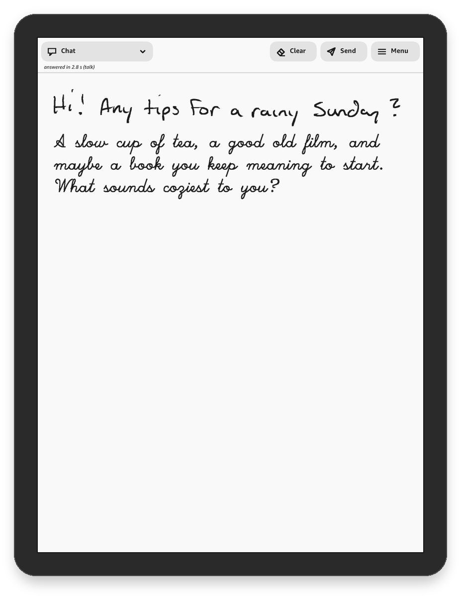
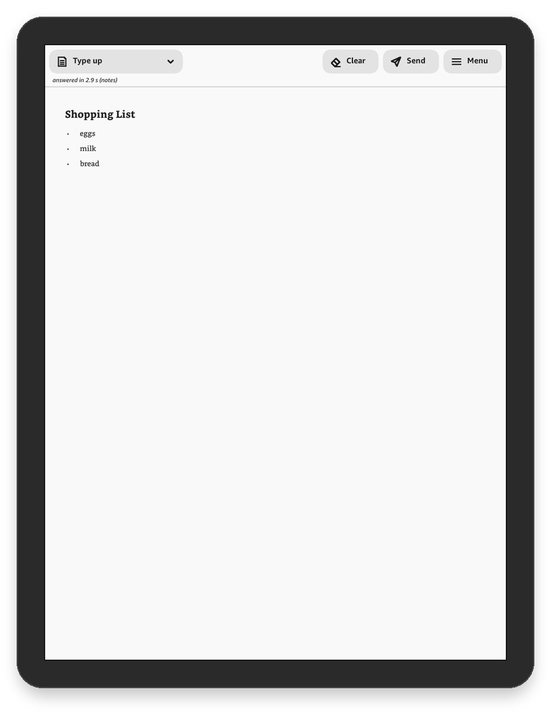
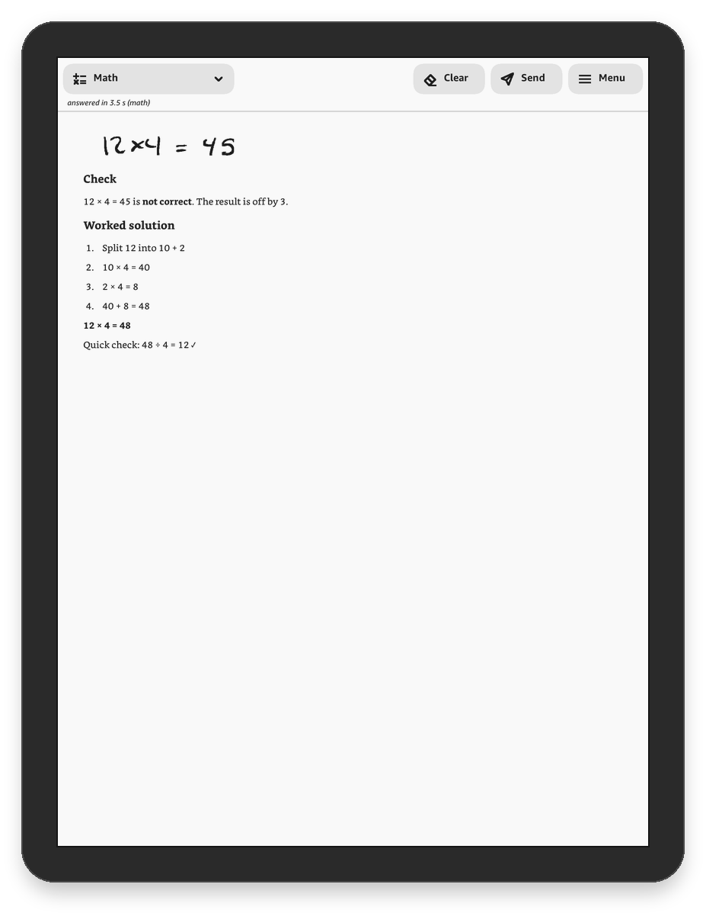
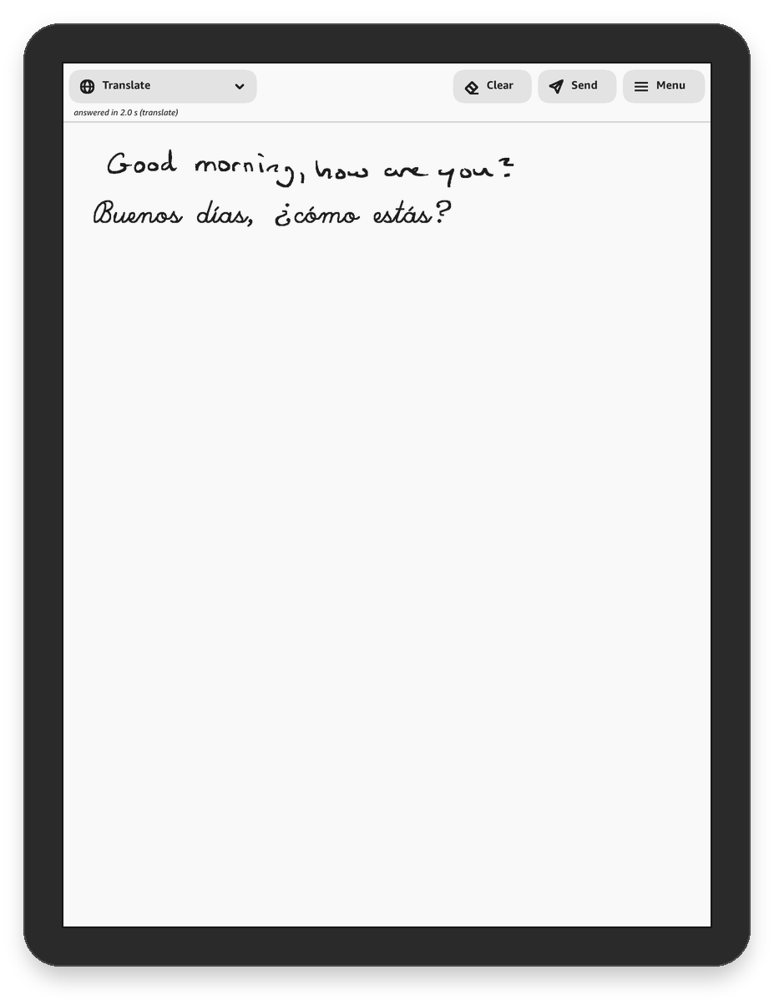
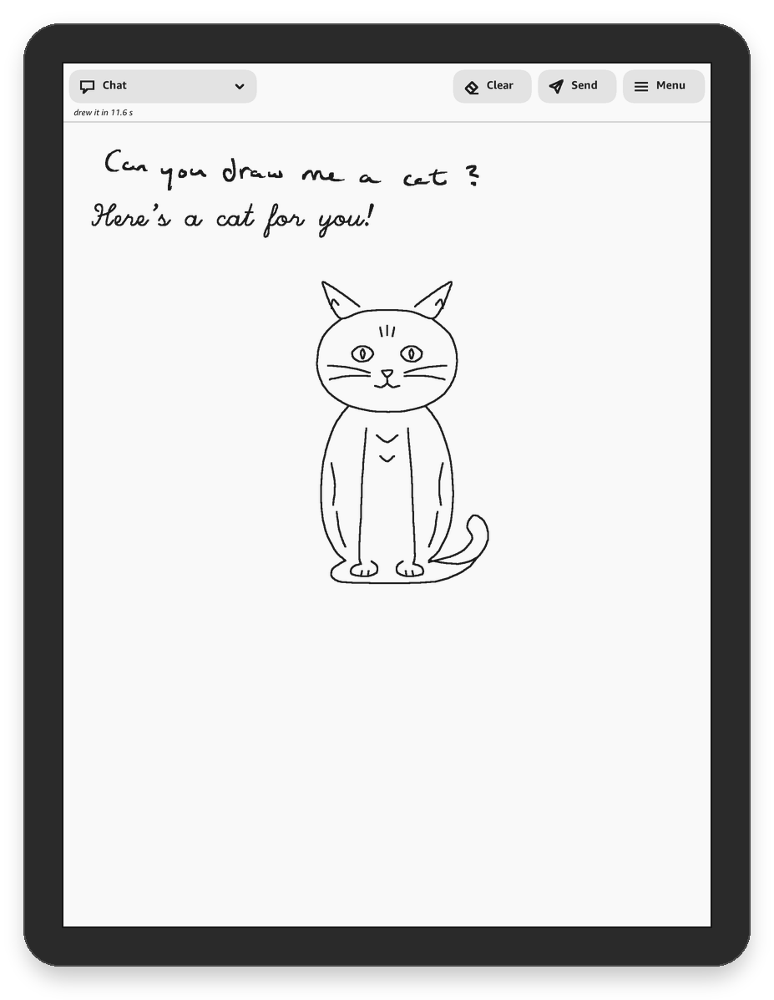
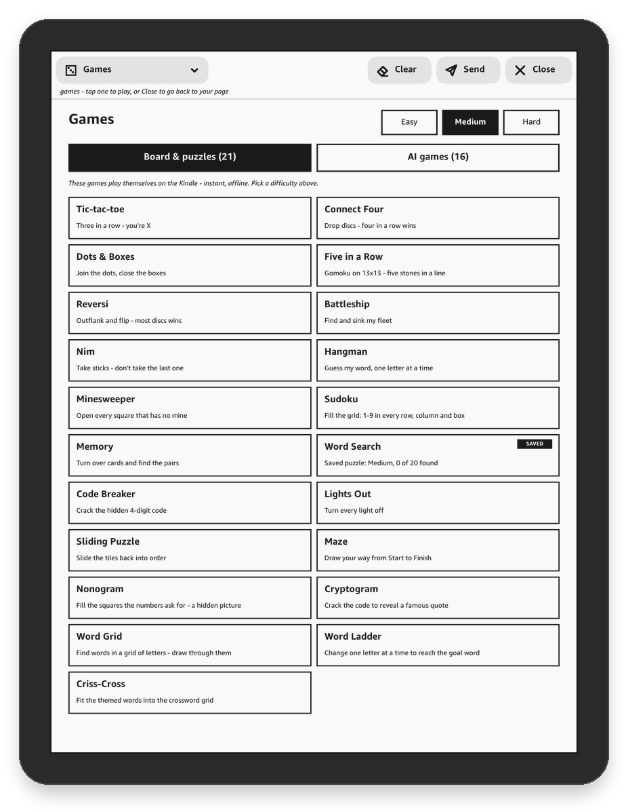
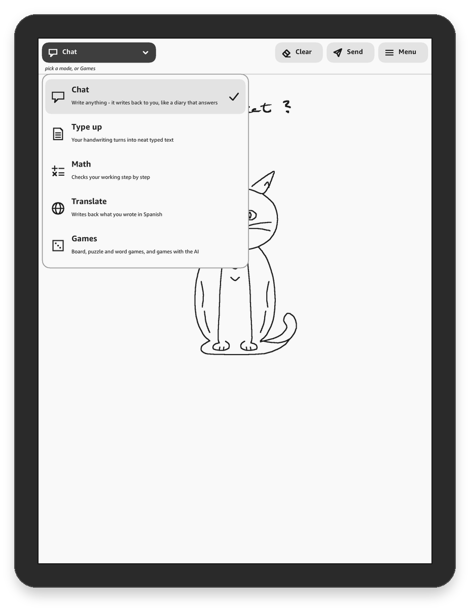
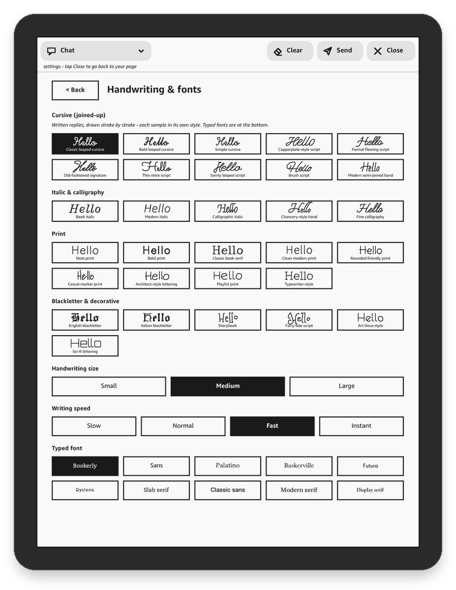

# Inkling


Inkling turns a jailbroken Kindle Scribe into a notebook that writes back. Write on the page, lift the pen, and a
couple of seconds later the reply appears underneath in handwriting, drawn stroke by stroke.

**[▶ Watch the demo (88 seconds)](../../releases/download/v0.3.0/inkling-demo.mp4)** ·
**[Download the latest release](../../releases/latest)**

Free and open source (GPL-3.0), published by JSSL.

<p>




</p>
<p>




</p>

## Contents

- [What it can do](#what-it-can-do)
- [How it works](#how-it-works)
- [What you need](#what-you-need)
- [Download and install](#download-and-install)
- [Add your API key](#add-your-api-key)
- [AI services and costs](#ai-services-and-costs)
- [Self-hosted AI servers](#self-hosted-ai-servers)
- [A different AI for each feature](#a-different-ai-for-each-feature)
- [Using Inkling](#using-inkling)
- [Email a page to yourself](#email-a-page-to-yourself)
- [Updating](#updating)
- [Uninstalling](#uninstalling)
- [Troubleshooting](#troubleshooting)
- [Privacy](#privacy)
- [Building from source](#building-from-source)
- [Reporting problems](#reporting-problems)
- [Licence](#licence)

## What it can do

- **Chat** about anything, in one of 30 voices, from a friendly pen pal to an evil wizard (18 everyday voices and 12
  fantasy ones).
- **Type up** your handwriting into neat text, right on the page, with headings, lists and tables.
- **Check your math** step by step, with hints or the full working.
- **Translate** what you write into another language, written back in handwriting.
- **Draw a picture** when you ask for one: a few seconds after the reply, your AI service's most capable model draws
  it as line art, stroke by stroke.
- **Play 21 games** that run on the Kindle itself (tic-tac-toe, connect four, reversi, sudoku, minesweeper, word
  search, nonograms, crosswords and more, with Easy, Medium and Hard), plus 16 AI games (I draw you guess, 20
  questions, trivia, mystery detective, dungeon quest...).
- **Email a page** to yourself, typed up, with a picture of the page attached.
- **Reply in any of 30 handwriting styles**, from looped cursive to blackletter, or in the Kindle's own fonts for
  typed text.
- **Turn pages** with a finger flick. The conversation carries on across pages, and your notebook stays on the Kindle:
  each page as an image, and the conversation as a text file you can copy to your computer.

## How it works

- Runs on the Kindle and talks straight to the AI service you choose, with no server in between. No computer is
  needed once it's installed.
- Bring your own API key: Claude, OpenAI, Google Gemini, Amazon Bedrock, xAI Grok, Mistral or OpenRouter. On
  Claude's default setting a reply costs under a cent ([AI services and costs](#ai-services-and-costs)). Or use
  [your own self-hosted AI servers](#self-hosted-ai-servers), and choose a different AI for each feature, with its
  model, thinking, temperature, reply length and your own instructions
  ([A different AI for each feature](#a-different-ai-for-each-feature)).
- Keys stay in root-only storage, pages only go to your AI service, and there's no analytics ([Privacy](#privacy)).
- Free and open source (GPL-3.0), with a reproducible build, so you can check the release matches the code
  ([Building from source](#building-from-source)).
- Signed updates from inside the app ([Updating](#updating)).
- Sleep, the cover and the passcode keep working as normal.

## What you need

1. **A Kindle Scribe.** Inkling is tested on the first-generation Scribe, firmware 5.19.6; reports from newer models
   are welcome (open an issue).
2. **A jailbroken Kindle** with the community jailbreak's *shell integration* (it lets you open `.sh` files from your
   Library) and root access. See [kindlemodding.org](https://kindlemodding.org); jailbreaking isn't covered here.
   Check that you can see and open `.sh` files in your Library before installing Inkling.
3. **Wi-Fi** on the Kindle.
4. **An API key** from one of the [AI services](#ai-services-and-costs), with billing set up on that account.
5. **A computer** and the Kindle's USB cable, for the install.

## Download and install

1. **Download** `inkling-<version>.zip` from the [latest release](../../releases/latest) and unzip it on your computer.
   Inside you'll find `README.txt`, `LICENSE.txt`, a `documents` folder with `Install Inkling.sh`, and an `inkling`
   folder (the app and its licences).
2. **Connect the Kindle** to your computer with the USB cable. It shows up as a drive with a `documents` folder.
3. **Copy the `inkling` folder** from the zip to the Kindle's main folder, next to `documents`.
4. **Copy `Install Inkling.sh`** from the zip's `documents` folder into the Kindle's `documents` folder.
5. **Eject** the Kindle (use your computer's eject or safely remove), then unplug it.
6. On the Kindle, open your **Library**, find **Install Inkling** and tap it. After a few seconds a message says
   *"Inkling ... installed"*.
7. An **Inkling** item with a quill icon is now in your Library. Next, add your API key.

The installer copies the app into the Kindle's protected storage and adds the Inkling item to your Library. It
doesn't change anything else on the Kindle.

## Add your API key

1. On your computer, make a plain text file that contains only your key, named for the service:

   | Service | Key file |
   |---|---|
   | Claude (Anthropic) | `anthropic-key.txt` |
   | OpenAI | `openai-key.txt` |
   | Google Gemini | `gemini-key.txt` |
   | Amazon Bedrock | `bedrock-key.txt` |
   | xAI Grok | `xai-key.txt` |
   | Mistral | `mistral-key.txt` |
   | OpenRouter | `openrouter-key.txt` |

   Use a plain-text editor and save as plain text (not a formatted document).
2. Connect the Kindle and copy the file into the **`inkling`** folder on the Kindle. Eject.
3. Open **Inkling**. It moves the key into protected storage on the Kindle and **deletes the text file**. The status
   line at the top says which AI it's using.

You can also type or paste a key on the Kindle in **Menu > Settings > AI** (the **AI services** tab), where **Test
key** checks it without spending anything. Keys for several services can be stored; pick the one to use and its model
on the same page. To use an AI server of your own instead, see [Self-hosted AI servers](#self-hosted-ai-servers).

## AI services and costs

Every service bills your own account; nothing goes through any other server. A reply sends a picture of the page, the
instructions and the recent conversation (a few thousand tokens) and gets a few hundred tokens back.

| Service | Where to get a key | Default model | Cost of a reply |
|---|---|---|---|
| Claude | [console.anthropic.com](https://console.anthropic.com) | `fast` (Haiku, with Sonnet for maths) | under a cent with the default; about 1-2 cents with Opus |
| OpenAI | [platform.openai.com](https://platform.openai.com) | `gpt-6.1-sol` | depends on the model |
| Google Gemini | [aistudio.google.com](https://aistudio.google.com) > Get API key | `gemini-3.8-flash` | a fraction of a cent; the free tier costs nothing, but Google uses free-tier prompts to improve its products |
| Amazon Bedrock | AWS console > Amazon Bedrock > API keys (use a long-term key) | `global.amazon.nova-2-lite-v1:0` | billed to your AWS account |
| xAI Grok | [console.x.ai](https://console.x.ai) | `grok-4.3` | about a cent |
| Mistral | [console.mistral.ai](https://console.mistral.ai) | `mistral-large-4` | under a cent |
| OpenRouter | [openrouter.ai/keys](https://openrouter.ai/keys) | `google/gemini-3.8-flash` | each model's own price, from prepaid credits |

**Amazon Bedrock** also needs the AWS region your key works in (Settings > AI, or `bedrock_region` in
`inkling/config.txt`; default `us-east-1`).

A drawing is made by the service's most capable model and costs a little more than a reply (a few cents with
Claude). The board and puzzle games run on the Kindle and cost nothing; AI games cost about the same as chatting. **Set a
monthly spending limit** on your key in the service's dashboard.

## Self-hosted AI servers

Inkling can use AI servers you run or choose yourself, instead of or as well as the services above: any server with
an OpenAI-compatible API, such as Ollama, LM Studio, llama.cpp, vLLM or LiteLLM, or one that speaks Anthropic's
Messages API or OpenAI's Responses API. A server can also be a cloud service's API with a key used for nothing else,
such as `https://api.openai.com/v1`.

Set them up in **Menu > Settings > AI**, on the **AI services** tab: tap **Self-hosted**, then **Set it up**. Up to
three servers can be set up (**+ Server** adds another); each has:

1. **Rename** (top right): what it's called on the Kindle, such as "Home Ollama" or "Work".
2. **Address**: the API's base address, for example `http://10.0.0.20:11434/v1` for Ollama on a computer at home,
   or `http://10.0.0.20:1234/v1` for LM Studio. The server must accept connections from the network, not only from
   its own computer. Clear the address to remove a second or third server.
3. **Kind of API**: *OpenAI-compatible* for almost every server.
4. **Key**: only if your server asks for one (cloud APIs always do). Or copy a file into the `inkling` folder:
   `custom-key.txt` for the first server, `custom2-key.txt` and `custom3-key.txt` for the others.
5. **Test & list models** asks the server for its models; tap one to use it, or type its name under **Model**.
6. **Wait for an answer up to**: how long a reply may take before Inkling gives up (3 minutes by default).
7. **Reply format**: *Auto* (default) finds out what the server can do; *Strict schema*, *JSON only* or *In the
   prompt* set it by hand.

Then tap the server under **Which AI answers** to use it for everything, or pick it for single features on the **Each
feature** tab.

Please read these before you rely on one:

- **The model must read images.** Inkling sends a picture of your page; a text-only model can't read your
  handwriting. Vision models are usually named with `vl`, `vision` or `llava`. Drawings are the exception: they send
  text only.
- **Expect slower and less accurate replies than the default services.** Small local models often misread
  handwriting, slip in maths and draw roughly, and on an ordinary computer a reply can take many seconds.
- **`http://` is not encrypted.** Your pages (and the key, if any) cross the network readable by anyone on it. Use
  `http://` only on your own home network; anywhere else use `https://` with a valid certificate (Inkling doesn't
  accept self-signed ones).
- **Give the model room.** A request is a few thousand tokens; with Ollama, set a context length of at least 16k
  (`OLLAMA_CONTEXT_LENGTH=16384`), or long pages get cut off.
- **Some servers can't hold replies to a JSON schema.** On *Auto*, Inkling finds out by itself: if a server refuses
  the schema, it asks again with the schema written into the instructions, and remembers that for that server.
- Inkling can't check what a server does with your pages. Use one you trust.

## A different AI for each feature

Inkling's defaults are chosen and tested for each feature on the Kindle: with Claude, Haiku for chat (quick), Sonnet
for maths (careful), Opus for drawings (detailed), each with a tuned amount of thinking. On the **Each feature** tab of
**Menu > Settings > AI**, each feature has its own page: Chat, Type up, Math, Translate, AI games, Drawings and Email
a page. Each page has two tabs.

**Service & model**

- **AI service**: *Default* (the one that answers everything, chosen on the AI services tab), or any of the AIs set up
  on the AI services tab: a service you have a key for, or one of your self-hosted servers. A feature uses that AI's
  key and server settings from the AI services tab; nothing is set up twice.
- **Model**: *Default* (Inkling's choice for that feature), one from the list (for a server, the models it reported),
  or **Other** to type any model name.

**Tuning & instructions**

- **Thinking**: *Default*, *Low*, *Medium* or *High*: how much the model thinks before it answers. Amazon Bedrock
  ignores it.
- **Temperature**: *Default* (the model's own), 0 (steadiest), 0.5 or 1 (most varied).
- **Longest reply**: *Default* (16,000 tokens), 2,000, 4,000, 8,000 or 32,000. Lower costs less but can cut a long
  reply off, which then fails; drawings need the most.
- **Your instructions**: your own words for the AI, added to Inkling's instructions for that feature, such as "I'm
  learning algebra, explain each step" for Math or "draw in a cartoon style" for Drawings. **Instructions for every
  feature** (at the end of the Each feature list) go to all of them, before each feature's own: "I'm 12, keep it
  simple" or "use British spelling". Up to 360 characters each.

Not every model takes a thinking level or a temperature; if one refuses, Inkling asks again without it. Your
instructions are added to Inkling's, never instead of them: the rules that lay replies out on the page and keep the
answer in the format Inkling reads stay in charge, so instructions can change what the AI says but not how it appears.

**Changing these can make Inkling worse, not better.** A bigger model or more thinking can make replies take two or
three times as long and cost more; a smaller model, a high temperature or a low reply limit makes more mistakes; a
wrong model name or a model that can't read images stops the feature working. The first time you open a feature's
page it says so and asks you to confirm. Each feature's page then shows **What to expect** for the choices you made,
and the status line says so when a reply on your own settings was slow or failed. **Use defaults** (on each feature)
and **Put every feature back to its default** undo everything, instructions included; they take two taps, so typed
instructions aren't lost to a slip.

Everything is also in `inkling/config.txt`, one line each, which is easier for long instructions than the Kindle's
keyboard. Per feature (`chat`, `typeup`, `math`, `translate`, `games`, `drawing`, `email`): `ai_<feature>` (the AI:
`default`, `anthropic`, `openai`, `gemini`, `bedrock`, `xai`, `mistral`, `openrouter`, or a server: `custom`,
`custom2`, `custom3`), `ai_<feature>_model`, `ai_<feature>_effort`, `ai_<feature>_temperature`,
`ai_<feature>_max_tokens` and `ai_<feature>_instructions`, plus `ai_instructions` for every feature. The servers:
`custom_name`, `custom_url`, `custom_api`, `custom_api_key` (moved into protected storage when the app starts),
`custom_model`, `custom_json` and `custom_timeout`, and the same as `custom2_...` and `custom3_...`. For example:

```
custom2_name = Work
custom2_url = https://ai.example.com/v1
custom2_model = gpt-6-astra
ai_math = custom2
ai_math_effort = high
ai_math_temperature = 0
ai_math_instructions = I'm learning algebra: explain each step and name the rule you used.
ai_instructions = Use British spelling.
```

## Using Inkling

Open **Inkling** from your Library. The top bar has:

- **Mode** (shows the current one, e.g. **Chat ▾**): Chat, Type up, Math, Translate or Games.
- **Clear**: clear this page, forget the conversation, delete this page, or start over. Tap an option twice: the first
  tap turns it dark.
- **Send**: answer right away instead of waiting for your pause, or **Email this page**.
- **Menu**: new page, **Settings**, **Check for updates**, **Exit**.

**Writing.** Write with the pen, then lift it and pause (1.5 seconds by default; Settings > Pen & timing). The reply
appears under your writing a couple of seconds later. If you carry on writing before it answers, it waits for your
next pause.

**Fixing mistakes.** Rub out with the eraser end of the pen if yours has one, or scribble back and forth over a word
to scratch it out. Rubbing out doesn't make the AI answer by itself; write the correction and it answers as usual.

**Pages.** Flick left with a finger for the next page (from the last page, that starts a new one); flick right for
the previous page.

**Leaving.** **Menu > Exit**, or press the **power button** (Inkling closes so the Kindle can sleep and lock as usual).
Your page is saved either way, and Inkling opens on the same page next time.

**Settings** (Menu > Settings): voices, reply length and language, handwriting style and size, typed font, translation
language, maths help, pen and pause timing, AI (services and keys, self-hosted servers, and a different AI, model,
tuning and instructions for each feature), and email. The same settings are saved in
`inkling/config.txt`, which you can also edit on a computer. Your notebook is in `inkling/notebooks/` on the Kindle's
USB storage: the pages as `page-0001.png` and so on, and the conversation as a `.md` text file.

## Email a page to yourself

**Send > Email this page** turns the page into an email: the AI types it up (a shopping list as a list, maths with its
working) and the page itself is attached as a picture. It goes out through your own email account, to yourself or to
the address you set.

Set it up once in **Menu > Settings > Email**: pick your email service, type your address and an **app password**. An
app password is a separate password your email service makes for one app; Inkling never needs your real password, and
you can delete the app password at any time. It stays on the Kindle in protected storage.

- **Gmail**: turn on 2-Step Verification, then go to myaccount.google.com/apppasswords, name it "Inkling" and type the
  16 letters it shows. Work or school accounts have this only if their administrator allows it.
- **Outlook, Hotmail, Live**: account.microsoft.com > Security > Advanced security options: turn on two-step
  verification, then App passwords > Create a new app password.
- **iCloud Mail**: account.apple.com > Sign-In and Security > App-Specific Passwords. Use your @icloud.com address.
- **Yahoo Mail**: Account Info > Account Security > Generate app password.
- **Fastmail**: Settings > Privacy & Security > Manage app passwords and access > New app password, with SMTP access.
- **Other server**: your mail service's outgoing (SMTP) server and port (465 for SSL/TLS, 587 for STARTTLS). The
  connection is always encrypted and the server's certificate is checked.
- **Resend** ([resend.com](https://resend.com), a sending service with a free tier) instead of your own account: sign
  up with the address you want pages sent to, create an API key with sending access, and enter it as the Resend key
  (or copy a `resend-key.txt` file holding only the key into the `inkling` folder).

If sending fails, the status line says why: *"refused the password"* means the app password is wrong or was deleted,
*"no connection"* means the Kindle couldn't reach the mail server, and a *certificate* message usually means the
Kindle's clock is wrong.

## Updating

**Menu > Check for updates.** The first tap asks GitHub whether a newer version is out; the second tap downloads it,
checks it, installs it and restarts Inkling. Your settings, keys and notebooks are kept, the previous version comes
back by itself if the new one fails to start, and nothing is checked or downloaded unless you tap.

Every update is signed with JSSL's release key, and Inkling carries the matching public key: it installs an update
only when the signature is valid and the download matches the signed checksum.

**Over USB** (always works): download the new release, copy its `inkling` folder and `Install Inkling.sh` to the
Kindle as in [Download and install](#download-and-install) (replacing the old ones), eject, and tap **Install
Inkling** again.

## Uninstalling

Copy **`Uninstall Inkling.sh`** from `inkling/install/` on the Kindle into the `documents` folder, eject, and tap
**Uninstall Inkling** in your Library. It removes the app, its Library item, your stored keys and the AI's
conversation memory. Your notebooks and `config.txt` stay in the `inkling` folder until you delete it yourself.

## Troubleshooting

- **"Install Inkling" or "Inkling" doesn't appear in the Library**: make sure the `.sh` file is directly inside
  `documents`, eject properly, and give the Library a minute to refresh. If `.sh` files never appear, the jailbreak's
  shell integration isn't installed.
- **Nothing happens when tapping Install Inkling**: look at `inkling/install-log.txt` on the Kindle. *"root (su) not
  found"* means the Kindle isn't fully jailbroken.
- **"Add your API key..."**: no key yet; see [Add your API key](#add-your-api-key).
- **"... rejected the API key"**: the key is wrong or revoked; make a new one.
- **"no internet connection?"**: check the Kindle's Wi-Fi, then tap **Send**.
- **"... is busy or at a usage limit"**: the AI service is overloaded or your spending limit was reached.
- **"couldn't reach Self-hosted ..."** (or **"... Math's server ..."**) **"is it running?"**: that server is off, its
  address is wrong, or it only accepts connections from its own computer (Ollama: set `OLLAMA_HOST=0.0.0.0`).
- **"... can't read images"**: the model on your own server (or the one picked for that feature) is text-only; pick a
  vision model.
- **"...'s AI setting failed"** or **"... may be slowing it down"**: a feature's own AI choice didn't work or is slow;
  open Settings > AI > Each feature and put that feature back to its default.
- **The screen looks stuck**: press the power button; Inkling closes and the Kindle returns to normal.

## Privacy

- **Your keys and app password stay on the Kindle**, in a folder only the system can read (not on the USB storage),
  and each is sent only to its own service. If the Kindle is lost, revoke the keys in the services' dashboards.
- **Your pages go only to the AI service you chose** (or the one picked for that feature; with a self-hosted server,
  to that server): when it answers, Inkling sends a picture of the current page and the recent
  conversation. That service's privacy terms apply. Emails go through the email service you set up.
- **Nothing else leaves the Kindle.** There are no accounts, analytics or tracking; JSSL never receives your pages,
  keys or replies. Inkling contacts GitHub only when you tap Check for updates.
- **You can check all of this in the source code**, which is in this repository.

## Building from source

[BUILDING.md](BUILDING.md) explains how to build Inkling with Zig, run its tests, and verify an official release: the
build is reproducible, so building a release's tagged source gives exactly the same app as the one in the download.

## Reporting problems

Bug reports are welcome: open an issue in this repository's [Issues](../../issues) tab and fill in the bug report
form. **Never paste API keys, app passwords or tokens** into an issue. Ideas and suggested changes are welcome as issues
too; the project doesn't take pull requests (they're closed automatically).

## Licence

Inkling is © 2026 JSSL and free software under the [GNU General Public License, version 3](LICENSE) (GPL-3.0-only):
you may use, study, change and share it, and if you share a changed version, you must share its source under the same
licence. It comes with no warranty. Jailbreaking a Kindle and running software as root is at your own risk, AI replies
can be wrong, and you're responsible for your own AI and email accounts and their costs. Third-party components and
their licences are listed in [THIRD-PARTY-NOTICES.md](THIRD-PARTY-NOTICES.md).

The Inkling name and icon identify JSSL's official releases. If you publish a changed version, please give it its own
name and icon, and its own signing key and releases page ([BUILDING.md](BUILDING.md) explains how).

Kindle and Kindle Scribe are trademarks of Amazon. Inkling isn't made or endorsed by Amazon or by any AI service.
